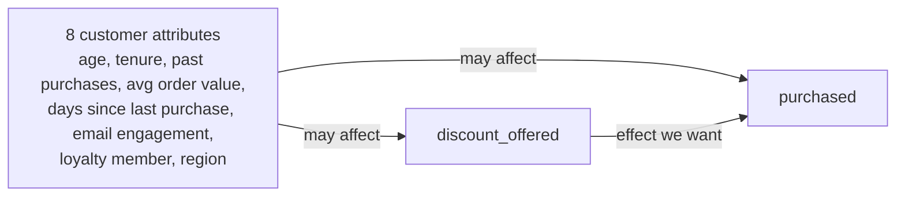

# Causal graph and variable roles

Code: `backend/econocausal/causal_graph.py`. Tests: `backend/tests/test_causal_graph.py`.
Status: DRAFT for Avinash's review. The graph is a set of assumptions, not something the data proves.

## The question
Does offering a 15% discount (`discount_offered`) change whether a customer buys (`purchased`), and by how much for each kind of customer?

## Picture

The attributes also affect each other: age -> tenure -> loyalty, tenure and loyalty -> past purchases,
loyalty -> email engagement, past purchases -> days since last purchase.

## Variable roles
| Role | Columns | Why |
|---|---|---|
| Treatment | `discount_offered` | The thing we want the effect of (0/1, fixed 15% depth) |
| Outcome | `purchased` | What we measure (0/1) |
| Confounders (adjust for) | all 8 attributes | Known before the offer; they influence who was offered a discount and who buys |
| Effect modifiers | the same 8 attributes | The discount effect may differ across them (heterogeneity) |
| Excluded | `customer_id` | Identifier only |
| Excluded | `order_value`, `discount_cost` | Measured AFTER the offer and zero unless the customer bought. They are results of the outcome, so adjusting for them would bias the estimate |

## Assumptions we are making (to be challenged in review)
1. **No hidden confounders.** Every cause of both the discount decision and the purchase is one of the 8 attributes. If a real dataset had another driver (for example a seasonal promotion), the estimate would be biased and no model could detect this from the data alone.
2. **Overlap.** Every kind of customer had a chance of being offered and not being offered the discount. Day 16 (propensity scores) checks this.
3. **Attributes come before the offer.** None of the 8 is changed by the discount.
4. **Binary treatment.** Only offered / not offered at a fixed 15% depth, so the model says nothing about other depths.

## What DoWhy adds
`scripts/check_causal_graph.py` asks DoWhy to identify the effect from this graph. DoWhy may pick a smaller valid adjustment set than all 8 attributes; adjusting for all 8 is also valid because none of them is affected by the discount. Output is saved to `docs/dowhy_identification.txt` after Avinash runs the script (not yet run).

## Open items
- Attribute-to-attribute edges: approved by Avinash on 20 Oct 2026.
- Day 8: choose which attributes go in X (effect modifiers) and which in W (controls only) when the DML model is built.
